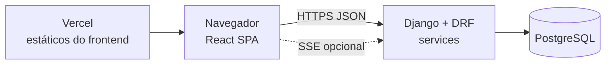

# Arquitetura técnica

Monólito modular: um backend Django, um frontend React, um PostgreSQL. Sem microserviços, sem fila, sem cache distribuído até haver dor medida (`padrao/arquitetura.md`).

## 1. Visão geral

- **Frontend** é só interface e estado de tela. Não decide preço, saldo, dono nem resultado.
- **Backend** é a única porta de escrita. O banco garante o que o código não pode quebrar.
- Analogia Django: o backend é um projeto Django comum; os "services" são o que muitos times chamam de *service layer* sobre `transaction.atomic`. Onde a analogia deixa de valer: aqui as views são finas **por regra** (teste verifica), porque a regra econômica precisa ser testável sem HTTP.

## 2. Estrutura do repositório (monorepo)
```
bahazar/
  backend/
    config/                 # settings, urls, asgi
    apps/
      accounts/             # NÚCLEO: usuário, perfil, auth (via biblioteca)
      rooms/                # NÚCLEO: grupos/lobbies (salas), membros, convites (PR 2.1 feita)
      friends/              # NÚCLEO: amizades e a permissão central de visibilidade
      economy/              # NÚCLEO: wallets globais, ledger, resgate diário, idempotência
      catalog/              # NÚCLEO: skins (global), import
      inventory/            # NÚCLEO: skin_instances
      marketplace/          # NÚCLEO: anúncios, compra
      cases/                # MÓDULO
      tradeups/             # MÓDULO
      progression/          # MÓDULO: xp, missões, conquistas
      leaderboard/          # MÓDULO: rankings
      seasons/              # MÓDULO (esquema agora, lógica depois)
      communities/          # MÓDULO (reservado; vazio)
    tests/
  frontend/
    src/{app,components,features,hooks,lib,services,types,utils}
  project/                  # docs
```
A estrutura de `frontend/src` segue o prompt (por feature). O `supabase/` do prompt **sai**; migrations vivem em cada app Django.

### Dentro de cada app Django
```
models.py        # persistência + constraints (sem regra de negócio)
services.py      # casca transacional: carrega, trava, chama o núcleo puro, grava
rules.py         # núcleo puro: funções sem I/O (preço por desgaste, taxa, validação de trade-up)
selectors.py     # consultas de leitura (sempre escopadas ao usuário: dono, amigo ou grupo)
serializers.py   # validação na borda
views.py         # fino: autentica, valida, chama service, serializa
permissions.py
tests/
```
- **Núcleo funcional, casca imperativa** (`arquitetura.md` §5): `rules.py` não importa Django; testa sem banco. `services.py` faz o I/O e é testado com Postgres real.
- Dependências apontam para dentro: `views → services → rules/models`. Sem ciclos.

## 3. Núcleo e módulos (modularidade)
- **Núcleo** (funciona sozinho): `accounts`, `rooms`, `friends`, `economy`, `catalog`, `inventory`, `marketplace`. Já entrega "amigos + dinheiro global + skins + mercado".
- **Revisão de 2026-11-19 (ADR 0010):** a economia é global por usuário e a sala é um grupo. Trocas entre amigos entram no núcleo (D6 muda); batalha de caixa é um módulo novo (`battles`) sobre `cases`.
- **Módulos**: `cases`, `tradeups`, `progression`, `leaderboard`, `seasons`, `communities`.
- Regras: o núcleo **não importa** módulo; módulo importa núcleo; **módulo não importa módulo**. Quando `cases` precisa pagar e entregar item, chama `economy.services` e `inventory.services` (núcleo). Quando `progression` precisa reagir a uma compra, **não** é chamado pelo `marketplace`: assina um sinal/evento do núcleo (`purchase_completed`) registrado no próprio módulo.
- Ausência graciosa: com um módulo desligado (`INSTALLED_APPS` por configuração), rotas e telas dele simplesmente não existem; o frontend consulta `GET /api/features/` e esconde o que não está instalado.
- **Não** construir sistema de plugins. Degrau da escada de modularidade: *ligar/desligar por configuração* (degrau a). Custo declarado: um teste de CI roda o núcleo sem módulos e cada módulo isolado.

## 4. Fluxos ponta a ponta

### 4.1 Comprar um anúncio do marketplace
```
Gatilho: jogador clica "Comprar" no anúncio L
   ↓
[frontend/features/marketplace: useBuyListing]  gera Idempotency-Key (uuid) e envia
   POST /api/v1/listings/L/buy   Header: Idempotency-Key: 7f3a...   Body: {}   → API →
   ↓                                  (nenhum preço, saldo ou dono no corpo)
[marketplace/views.py: BuyListingView]  autentica, valida UUIDs, limite de taxa → service →
   ↓
[marketplace/services.py: buy_listing(user, listing_id, key)]
   transaction.atomic():
     1. idempotência: se (user,key) já existe → devolve resposta gravada (fim)
     2. trava: listing (FOR UPDATE) → skin_instance (FOR UPDATE) → wallets comprador/vendedor/system ordenadas por UUID
     3. rules.can_buy(...): status=active, buyer≠seller, instância não consumida, saldo ≥ preço
     4. rules.split_price(price, fee_bps) → (to_seller, fee)  (inteiros, arredondamento definido)
     5. economy.services.post_entries(group): comprador -P, vendedor +(P-fee), system +fee (atualiza balances)
     6. inventory: instance.owner = comprador; listing.status='sold'; grava market_transactions + activity_log
     7. grava resposta de idempotência
   ↓ (commit)
Resultado: 200 {listing: sold, new_balance} → frontend invalida caches de inventário/carteira/mercado
```
Para cada salto:
| Salto | Dado | Onde falha e o que acontece | Confiança | Camada |
|---|---|---|---|---|
| frontend → API | só o id na URL + chave | rede cai: cliente reenvia com **a mesma chave**; resposta idêntica, 1 débito | **fronteira**: tudo vindo daqui é suspeito | navegador → servidor |
| view | UUIDs, usuário da sessão | 401/403/404 (anúncio inexistente ou sem visibilidade = 404, não revela existência) | valida tipo e visibilidade | servidor |
| trava | linhas travadas | outra compra concorrente espera; ao liberar, vê `sold` e recebe 409 | - | PostgreSQL |
| ledger | grupo soma zero | `CHECK balance>=0` violado → rollback total, 422 "saldo insuficiente" | banco é a última defesa | PostgreSQL |
| commit | tudo ou nada | falha no meio → rollback; nada parcial | - | PostgreSQL |

### 4.2 Abrir uma caixa
```
Gatilho: clique em "Abrir" na caixa C
   ↓
[view] POST /api/v1/cases/C/open  (Idempotency-Key)  → service →
   ↓
[cases/services.py: open_case]  atomic():
   idempotência → trava wallet do jogador → confere C.status='published' e saldo
   → economy.post_entries(jogador -preço, system +preço)
   → rules.pick_drop(drops, roll)   roll = secrets.randbelow(total_weight)   (CSPRNG, servidor)
   → inventory.create_instance(skin, float sorteado dentro da faixa da skin)
   → grava case_openings(drops_snapshot, roll)
   ↓
Resultado: a skin sorteada (já na posse do jogador). O cliente só anima.
```
Falha comum: sortear fora da transação de pagamento (permitiria "tentar de graça"). Aqui pagar e sortear são atômicos.

### 4.3 Trade-up
```
Gatilho: jogador seleciona N skins e uma receita
   ↓
[view] POST /api/v1/tradeups  {recipe_id, instance_ids:[...]}  (Idempotency-Key)
   ↓
[tradeups/services.py: execute_tradeup]  atomic():
   trava as instâncias (ordenadas) → rules.validate(recipe, inputs):
     todas do jogador, não consumidas, não anunciadas, raridade e quantidade da receita
   → rules.compute_output(inputs): saída ponderada pelas coleções das entradas; float = média normalizada à faixa da saída
   → RNG no servidor → marca entradas consumed_at → cria instância de saída → grava tradeup_history/inputs
   ↓
Resultado: nova skin no inventário; entradas somem do inventário (continuam no banco para auditoria)
```
Corpo contém ids das instâncias **escolhidas pelo usuário** (entrada legítima), mas todas são revalidadas contra o banco.

## 5. Idempotência (como funciona)
1. Cliente gera `Idempotency-Key` ao **abrir o diálogo** de confirmação (uma por intenção; reusada em retries).
2. Servidor, **na mesma transação da operação** (`economy.idempotency.run_once`, ADR 0014), insere `idempotency_records(scope, key, request_hash)` num savepoint.
3. Se inseriu → executa e grava a resposta no registro; tudo confirma junto. Se já existia com o mesmo hash → devolve a resposta gravada, sem executar. **Não existe o estado "em andamento" nem o `409 Retry-After`:** um pedido simultâneo com a mesma chave espera, no `INSERT`, a primeira transação terminar e então lê a resposta pronta. Operação que falha desfaz o registro junto (a chave não fica queimada).
4. Mesma chave com `request_hash` diferente → `IdempotencyKeyReused` (a rota que usar isso responde `422`).
5. Registros expiram: `manage.py expire_idempotency` (PR #118) apaga os mais antigos que N dias (padrão 7, **hipótese sem fonte**); é **manual**, sem agendamento. O ledger guarda a chave própria, permanente: é ele que barra a repetição de uma transferência depois da expiração (o `IntegrityError` do UNIQUE desfaz tudo). Operação futura sob `run_once` sem chave UNIQUE própria só tem a retenção como defesa (PENDING); o criar anúncio (4.4b) é a exceção aceita pelo dono (ADR 0018, adendo).

## 6. API
- REST + JSON sob `/api/`, versionada (`/api/v1/`). Recursos de jogo são **globais por usuário** (`/api/v1/wallet/`, `/api/v1/inventory/`, `/api/v1/friends/`); só os grupos ficam em `/api/v1/rooms/{room}/...`.
- Contrato **OpenAPI** gerado do backend; tipos TS gerados no frontend (fonte única; evita desvio).
- Erros padronizados `{code, message, details}` com `code` estável (`insufficient_funds`, `listing_not_active`...) para o frontend traduzir.
- Paginação por cursor em listas grandes (extrato, vitrine); tamanho máximo fixo.

## 7. Tempo real
Decisão em duas fases (YAGNI):
1. **Etapas 1-5:** sem tempo real; vitrine e inventário atualizam por *refetch* (TanStack Query) ao focar a aba e a cada ~10-15 s na vitrine. Barato e suficiente para um grupo pequeno.
2. **Etapa 6:** **SSE** (Server-Sent Events, um canal por grupo ou por usuário) sobre ASGI, com `LISTEN/NOTIFY` do próprio Postgres como barramento. Sem Redis e sem WebSocket, porque só há envio servidor → cliente e só para `market_listings`/ranking.
   Quando WebSocket/Channels valeria: chat, jogo em tempo real bidirecional. Não está no escopo.
   Confiança **média**: SSE em ASGI e `LISTEN/NOTIFY` funcionam, mas o desenho de fan-out entre processos precisa ser medido num protótipo antes de adotar (RISCOS R7).

## 8. Frontend
- `features/<x>/` contém `api` (chamadas), `hooks`, `components`, `types`. Estado de servidor com **TanStack Query**; estado local com `useState`/Context; sem Redux/Zustand até haver dor (um gerenciador de estado, não três).
- Componentes de apresentação puros; regra de negócio (ex.: preço por desgaste exibido) vem pronta do backend; o cliente só formata (`Intl.NumberFormat` sobre inteiros em centavos).
- Visual: tema escuro (preto/grafite), vermelho de destaque, cores por raridade, cards de skin, gráficos de patrimônio, responsivo. Detalhamento de design na etapa 6 e com a skill `frontend-design`.
- Rotas por feature (React Router), carregamento preguiçoso por rota.

## 9. Ambientes e infraestrutura
| Item | Proposta | Observação |
|---|---|---|
| Frontend | Vercel | deploys de preview por PR |
| Backend | contêiner (Gunicorn/Uvicorn) em PaaS ou VPS | **decisão D2 pendente** (Fly.io, Railway, Render, VPS) |
| Banco | PostgreSQL gerenciado | **D2**; backup diário + teste de restauração |
| Ambientes | `dev` (local leve), `staging`, `prod` com bancos e segredos separados | local **sem** build/teste pesado (ADR 0009 do workspace) |
| Observabilidade | logs estruturados + captura de erros | ferramenta pendente (RISCOS) |
| Cache | nenhum no início | adicionar só com medição |

## 10. Decisões estruturais (candidatas a ADR; perguntar antes de gravar)
| # | Decisão | Alternativas descartadas |
|---|---|---|
| A1 | Django + DRF no lugar de Supabase | Supabase (rejeitado pelo dono: BaaS); FastAPI/Rust/Nest (mais peças a montar) |
| A2 | Regras econômicas em services transacionais Django | Procedures PL/pgSQL (regra no banco, mais difícil de testar/versionar para quem vem de Django); lógica no cliente |
| A3 | Ledger de partida dobrada com carteira `system` | Saldo mutável sem histórico; ledger de entrada simples (não permite reconciliar a oferta monetária) |
| A4 | Autorização no código + reforços no banco (sem RLS agora) | RLS com `SET LOCAL` (complexo; reavaliar ao abrir ao público) |
| A5 | Polling primeiro, SSE depois | Channels/WebSocket desde o início (infra e complexidade sem necessidade) |
| A6 | Monólito modular com núcleo/módulos por app Django | Microserviços; monólito sem fronteiras |
