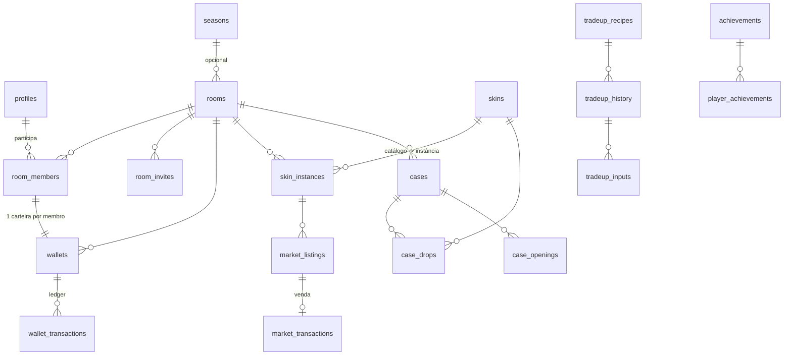

# Modelo de dados

PostgreSQL é a fonte da verdade. As garantias de integridade (FK, CHECK, UNIQUE, índices parciais, triggers) ficam **no banco**, não só no Django: um bug de aplicação não pode criar saldo negativo nem dois anúncios ativos do mesmo item.

> Estado: proposta para revisão. SQL **não executado**; nomes e tipos são o contrato de desenho, o Django os materializa em migrations.

## 1. Convenções
1. PK `uuid` (v4, `gen_random_uuid()`) em todas as tabelas, exceto onde indicado.
2. `created_at timestamptz NOT NULL DEFAULT now()` em tudo; `updated_at` só onde há mutação legítima.
3. **Dinheiro = inteiro.** Unidade: `bigint` em "centavos" do jogo (1 unidade = 0,01 moeda virtual). Nunca `float`/`double`/`numeric` para saldo, preço ou taxa. Taxas em **basis points** (`int`, 100 = 1%), com arredondamento definido em um único lugar (função pura de serviço, com teste).
4. **Isolamento por sala.** Toda tabela de jogo tem `room_id` (FK). Mesmo quando redundante (ex.: `skin_instances` ↔ `wallets`), a coluna existe para permitir CHECK/FK composta e filtro obrigatório (ver SEGURANCA §3).
5. Enums como `text` + `CHECK (col IN (...))` (migração mais simples que `ENUM` nativo).
6. Registros financeiros e de resultado (ledger, aberturas de caixa, trade-ups, transações de mercado) são **append-only**.
7. Nomes em inglês `snake_case` (convenção Django); documentação em português.

## 2. Diagrama (visão geral)

## 3. Tabelas

### 3.1 Identidade e salas
| Tabela | Campos principais | Constraints e índices |
|---|---|---|
| `profiles` | `id` (= `auth_user.id`, 1:1), `username` (citext), `avatar_url`, `xp`, `level` | `UNIQUE(username)` case-insensitive; CHECK formato do username (`^[a-z0-9_]{3,20}$`); `xp >= 0` |
| `rooms` | `id`, `name`, `owner_id` → profiles, `visibility` (`private`\|`public`), `starting_balance`, `market_fee_bps`, `max_members`, `season_id` null, `archived_at` | `starting_balance >= 0`; `market_fee_bps BETWEEN 0 AND 5000`; `visibility='private'` por padrão (público só no futuro) |
| `room_members` | `id`, `room_id`, `user_id`, `role` (`owner`\|`admin`\|`member`), `joined_at`, `status` (`active`\|`left`\|`banned`) | `UNIQUE(room_id, user_id)`; índice `(user_id, room_id)` (consulta "minhas salas" e checagem de pertencimento); **exatamente um `owner` ativo por sala** (índice único parcial `WHERE role='owner' AND status='active'`) |
| `room_invites` | `id`, `room_id`, `created_by`, `code_hash` (bytea), `expires_at`, `max_uses`, `uses`, `revoked_at` | `UNIQUE(code_hash)`; `uses <= max_uses`; o código em claro **nunca** é gravado (ver SEGURANCA §5) |

### 3.2 Economia (núcleo financeiro)
| Tabela | Campos principais | Constraints e índices |
|---|---|---|
| `wallets` | `id`, `room_id`, `user_id` null, `kind` (`player`\|`system`), `balance` bigint, `version` | `UNIQUE(room_id, user_id)`; **uma `system` por sala** (índice único parcial); `CHECK (kind='system' OR balance >= 0)`; `CHECK ((kind='player') = (user_id IS NOT NULL))`; FK composta garantindo que o `user_id` é membro da `room_id` |
| `wallet_transactions` | `id`, `room_id`, `wallet_id`, `group_id` (uuid do lançamento), `amount` bigint (assinado, ≠ 0), `balance_after` bigint, `kind`, `ref_type`, `ref_id`, `idempotency_key`, `created_at` | **append-only** (ver §4); `UNIQUE(wallet_id, idempotency_key)`; índice `(wallet_id, created_at DESC, id)` (extrato paginado); índice `(room_id, group_id)`; `kind IN ('starting_grant','transfer','market_sale','market_purchase','market_fee','case_open','case_reward','tradeup','quest_reward','adjustment')` |

### 3.3 Catálogo (global) e inventário (por sala)
| Tabela | Campos principais | Constraints e índices |
|---|---|---|
| `skins` | `id`, `external_id` (id do dado-fonte), `weapon`, `name`, `collection`, `rarity`, `min_float`, `max_float`, `reference_price` bigint, `image_url`, `image_source`, `active` | `UNIQUE(external_id)`; `0 <= min_float < max_float <= 1`; `reference_price > 0`; **global**, sem `room_id`; leitura por qualquer autenticado, escrita só por import administrativo |
| `skin_instances` | `id`, `room_id`, `skin_id`, `owner_id`, `float_value` numeric(10,9), `acquired_via`, `acquired_at`, `acquired_ref_id`, `consumed_at` null, `consumed_ref_id` null | cada instância tem **um** dono (`owner_id NOT NULL`); FK composta `(room_id, owner_id)` → `room_members`; CHECK do float dentro de `[skin.min_float, skin.max_float]` (trigger, pois cruza tabelas); índices `(room_id, owner_id)` e `(room_id, skin_id)` |

O **desgaste** (FN/MW/FT/WW/BS) não é coluna: é derivado de `float_value` por função pura (faixas padrão: 0-0,07-0,15-0,38-0,45-1). Evita inconsistência entre float e rótulo.

### 3.4 Marketplace
| Tabela | Campos principais | Constraints e índices |
|---|---|---|
| `market_listings` | `id`, `room_id`, `skin_instance_id`, `seller_id`, `price` bigint, `status` (`active`\|`sold`\|`cancelled`), `created_at`, `closed_at` | `price > 0`; **`UNIQUE(skin_instance_id) WHERE status='active'`** (uma skin, um anúncio ativo); índice `(room_id, status, created_at DESC)` para a vitrine; índice `(seller_id)` |
| `market_transactions` | `id`, `room_id`, `listing_id` (UNIQUE), `buyer_id`, `seller_id`, `price`, `fee`, `ledger_group_id`, `idempotency_key` | **append-only**; `buyer_id <> seller_id`; `UNIQUE(listing_id)` (um anúncio só vende uma vez); `UNIQUE(buyer_id, idempotency_key)` |

### 3.5 Caixas e trade-ups (módulos)
| Tabela | Campos principais | Constraints e índices |
|---|---|---|
| `cases` | `id`, `room_id` null (global ou da sala), `name`, `price` bigint, `status` (`draft`\|`published`\|`retired`) | `price >= 0`; **imutável após `published`** (drops e pesos congelados) |
| `case_drops` | `id`, `case_id`, `skin_id`, `weight` int (partes por milhão) | `weight > 0`; `UNIQUE(case_id, skin_id)`; soma dos pesos = 1 000 000 verificada **na publicação** (CHECK entre linhas não existe; validado no serviço + teste e conferido por query de auditoria) |
| `case_openings` | `id`, `room_id`, `case_id`, `user_id`, `price_paid`, `result_instance_id`, `result_skin_id`, `roll` int, `drops_snapshot` jsonb, `ledger_group_id`, `idempotency_key` | **append-only**; `drops_snapshot` guarda pesos usados e `roll`, permitindo **verificar** depois que o sorteio respeitou as probabilidades |
| `tradeup_recipes` | `id`, `name`, `input_rarity`, `input_count`, `output_rarity`, `rules` (colunas explícitas, não jsonb livre: ex. `same_collection_required`) | `input_count >= 2` |
| `tradeup_history` | `id`, `room_id`, `recipe_id`, `user_id`, `result_instance_id`, `outcome_snapshot` jsonb, `idempotency_key` | **append-only** |
| `tradeup_inputs` | `tradeup_id`, `skin_instance_id`, `float_value` | entradas consumidas; `UNIQUE(skin_instance_id)` (item só é consumido uma vez) |

### 3.5.1 Trade-up: consumo de itens
As instâncias consumidas **não são apagadas**: recebem `skin_instances.consumed_at` (e `consumed_ref_id`). Elas somem do inventário, do mercado e do ranking pelo filtro `consumed_at IS NULL`, mas permanecem para auditoria. Vale para qualquer "destruição" futura. Alternativa descartada: `DELETE` (perde histórico e quebra FK de `tradeup_inputs`).

### 3.6 Progressão e competição
| Tabela | Campos principais | Constraints e índices |
|---|---|---|
| `achievements` | `id`, `code` (UNIQUE), `name`, `description`, `reward` bigint, `xp` | catálogo global |
| `player_achievements` | `id`, `room_id`, `user_id`, `achievement_id`, `unlocked_at`, `ledger_group_id` null | `UNIQUE(room_id, user_id, achievement_id)` (não ganha duas vezes) |
| `seasons` | `id`, `name`, `starts_at`, `ends_at`, `status` | `ends_at > starts_at`; **só o esquema agora** |
| `quests`, `player_quests` | missões e progresso por jogador/sala | justificativa: o prompt exige "missões" (§5.9) mas não as lista em §6 |
| `activity_log` | `id`, `room_id`, `actor_id`, `action`, `target_type`, `target_id`, `data` jsonb, `created_at` | histórico de atividade do §5.1/5.2; índice `(room_id, created_at DESC)`; append-only |
| `idempotency_records` | `id`, `scope` (user/room), `key`, `request_hash`, `response_status`, `response_body`, `created_at` | `UNIQUE(scope, key)`; guarda a resposta da primeira execução para operações que não gravam `idempotency_key` na própria linha |

Rankings (patrimônio, saldo, valor do inventário, evolução) **não são tabelas-fonte**: são consultas (e, se pesarem, uma *materialized view* ou tabela `net_worth_snapshots` por sala/dia, decidida com medição; ver RISCOS).

## 4. Ledger financeiro

### 4.1 Forma
Partida dobrada simplificada: cada operação gera um **grupo** (`group_id`) de 2 ou mais linhas em `wallet_transactions` cuja soma de `amount` é **zero**. Todo dinheiro "criado" ou "destruído" passa pela carteira `system` da sala:

| Operação | Linhas (mesmo `group_id`) |
|---|---|
| Saldo inicial | system `-S`, jogador `+S` |
| Transferência A→B de X | A `-X`, B `+X` |
| Compra no mercado, preço P, taxa F | comprador `-P`, vendedor `+(P-F)`, system `+F` |
| Abrir caixa, preço C | jogador `-C`, system `+C` |
| Recompensa R | system `-R`, jogador `+R` |

**Invariante global (reconciliação):** `SUM(amount)` por sala = 0, e `wallets.balance = SUM(amount)` por carteira. Duas queries de auditoria rodam no CI e num comando periódico. Se qualquer uma falhar, há bug ou adulteração.

A carteira `system` pode ficar negativa (é a fonte do dinheiro); as de jogador, não (`CHECK balance >= 0`). **Oferta monetária da sala** = `-system.balance`, métrica útil contra inflação.

### 4.2 Saldo: coluna em cache, não verdade
`wallets.balance` existe para leitura rápida e para o `CHECK >= 0`. É atualizado **somente** pela função de serviço, na mesma transação do lançamento, e conferido contra `SUM(amount)`. A verdade é o ledger. `balance_after` em cada linha permite achar o ponto exato de uma divergência.

### 4.3 Imutabilidade (defesa em profundidade)
1. O papel do banco usado pela aplicação **não tem `UPDATE` nem `DELETE`** em `wallet_transactions`, `market_transactions`, `case_openings`, `tradeup_history` (`REVOKE`).
2. Trigger `BEFORE UPDATE OR DELETE` que levanta exceção (cobre superusuário distraído e migração errada).
3. Correção de erro = **lançamento compensatório** (`kind='adjustment'`), nunca edição.
4. `TRUNCATE` revogado; backups testados (ver RISCOS).

### 4.4 Idempotência
Todo endpoint que move valor exige o header `Idempotency-Key` (UUID gerado pelo cliente por intenção do usuário). A chave é única por escopo; repetir a mesma chave devolve o resultado original; chave igual com corpo diferente → `422`. Detalhe em ARQUITETURA §5.

## 5. Índices para consultas frequentes (resumo)
| Consulta | Índice |
|---|---|
| "Minhas salas" / é membro? | `room_members(user_id, room_id)` |
| Vitrine do mercado | `market_listings(room_id, status, created_at DESC)` |
| Inventário filtrado | `skin_instances(room_id, owner_id)` + join `skins(weapon, rarity)` |
| Extrato | `wallet_transactions(wallet_id, created_at DESC, id)` (paginação por *keyset*, não OFFSET) |
| Ranking por patrimônio | agregação por sala; índice `skin_instances(room_id, owner_id) WHERE consumed_at IS NULL` |
| Convite por código | `room_invites(code_hash)` |

## 6. O que fica explicitamente fora do modelo agora
Stickers, StatTrak/Souvenir, padrões (pattern index), listas de preço externas em tempo real, ofertas diretas de troca 1:1 entre jogadores (o prompt fala em "negociações", mas só o marketplace está especificado: ver RISCOS, decisão D6).
